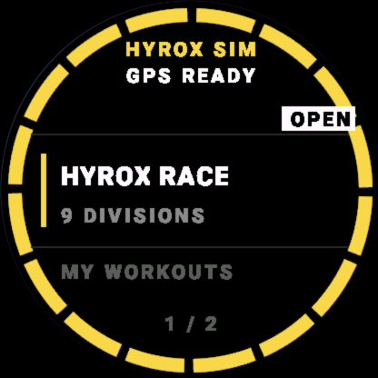
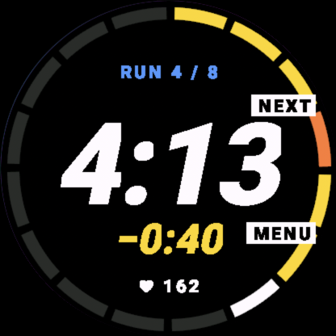
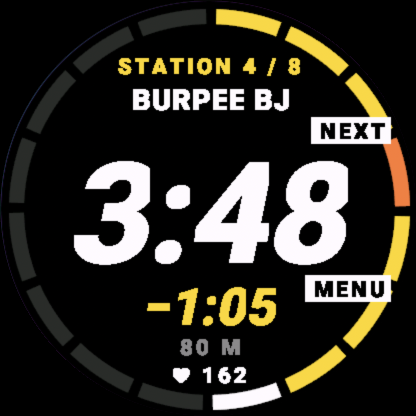
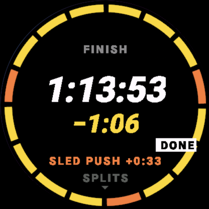
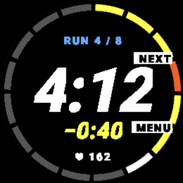
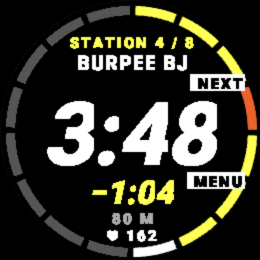
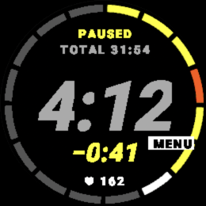
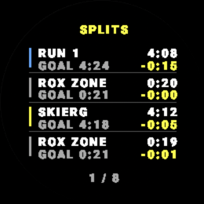

# HyroxSim-Garmin

HYROX 경기 시뮬레이터 — Garmin Connect IQ 워치 앱.

iOS/안드로이드 메인 앱과 양방향 동기화:
- iOS → 워치: 목표 시간, 디비전
- 워치 → iOS: 운동 결과 (HR 포함)

## 화면 (2.0)

블랙 + 골드, 폰 앱 2.0 과 같은 디자인. 화면 테두리의 16칸 링이 레이스 진행을 보여 준다
(런 8 + 스테이션 8, ROX 존은 옆 런에 포함). 끝난 칸은 목표보다 빠르면 골드, 느리면 오렌지,
지금 칸은 흰색. 터치가 없어도 쓸 수 있게 START·BACK 버튼 옆에 동작이 적혀 있다.

| 홈 | 런 | 스테이션 | 결과 |
|---|---|---|---|
|  |  |  |  |

fēnix 7 (260px, MIP 64색):

| 런 | 스테이션 | 일시정지 | 구간 기록 |
|---|---|---|---|
|  |  |  |  |

전체 캡처: `docs/screenshots/2.0/<기기>/` (fr265·fenix7 은 20개 화면 전부).

## 빌드 & 실행

### 사전 요구사항
- macOS
- Connect IQ SDK 9.1.0 이상 (SDK Manager로 설치, 9.2.0 에서도 빌드 확인)
- VS Code + Monkey C 확장 (Garmin 공식)
- 생성된 `developer_key.der` (프로젝트 루트)

### 첫 실행

```bash
# 시뮬레이터에서 실행 (fr265 | fr965 | fenix7 | fenix847mm | vivoactive5)
./scripts/run-sim.sh fr265

# 빌드만
./scripts/build.sh fr265

# 단위 테스트 (시뮬레이터 필요)
./scripts/test.sh fenix7

# 실제 워치에 올릴 빌드
./scripts/build.sh fr265
```

**디버그 빌드는 폰과 통신하지 않는다.** 시뮬레이터에는 폰이 없어서 전송할 때마다
"There is no data connection" 경고창이 뜨기 때문에, 디버그·테스트 빌드에서는 폰 연결을
꺼 두었다 (`phoneLinkEnabled()`, `source/Sync/PhoneMessageHandler.mc`). 폰 동기화를
`./scripts/build.sh` 의 기본은 실기기용 릴리스 빌드다. 시뮬레이터용 디버그 빌드는 `DEBUG=1` 을 붙인다(`run-sim.sh`, `test.sh` 가 알아서 붙인다). 스토어용 `.iq` (`scripts/package.sh`)는
항상 릴리스 빌드다.

### 화면 바로 보기

운동 중·결과 화면을 버튼 조작 없이 띄우는 디버그 전용 진입점이 있다.

```bash
tools/screenshots/shoot.sh station fr265 bin/shot.prg   # 화면 이름은 스크립트 주석 참고
tools/screenshots/shoot.sh tour fenix7 bin/tour.prg     # 모든 화면을 차례로
```

`(:debug)` 코드라 릴리스 빌드에는 들어가지 않는다.

### 폰트 다시 만들기

숫자·캡션 폰트는 Roboto Black (Apache-2.0) 을 화면 크기별로 구운 비트맵이다.

```bash
swift tools/numfont/build.swift    # resources*/fonts/ 를 전부 다시 만든다
```

## 디렉토리 구조

| 경로 | 내용 |
|---|---|
| `source/` | Monkey C 소스 (Domain/Engine/Sensors/Goal/Sync/Storage/UI/Debug/Tests) |
| `resources/` | 문자열, 아이콘, 454px 화면용 폰트 |
| `resources-<기기>/` | 화면 크기가 다른 기기의 아이콘·폰트 |
| `docs/` | 포팅 스펙, 메시지 프로토콜, 기기 지원 매트릭스, 스크린샷 |
| `scripts/` | 빌드/실행/테스트/패키징 |
| `tools/numfont/` | 폰트 생성기 |
| `tools/screenshots/` | 화면 바로가기 빌드 |
| `.handoffs/` | 세션 연속성용 작업 메모 |

## 문서

- [SETUP.md](docs/SETUP.md) — 개발 환경 셋업
- [SPEC.md](docs/SPEC.md) — HyroxCore ↔ Monkey C 포팅 스펙
- [MESSAGE_PROTOCOL.md](docs/MESSAGE_PROTOCOL.md) — iOS/Android ↔ 워치 JSON 스키마
- [DEVICE_SUPPORT.md](docs/DEVICE_SUPPORT.md) — 지원 기기 매트릭스
- [CLAUDE.md](CLAUDE.md) — Claude Code 작업 규칙

## 라이선스

미정.
